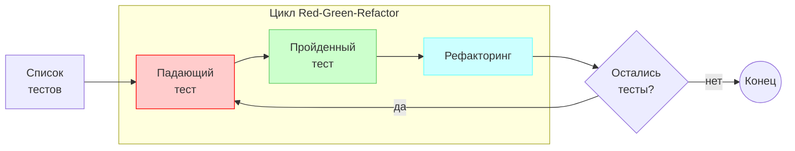

# Каноничный TDD и список тестов

TDD (Test Driven Development) — это процесс написания кода через тестирование.

Это полностью меняет процесс написания кода:

- TDD используется как способ проектирования модуля (класса, файла и т.п.)
- Тесты остаются в роли документации модуля — хороший тест демонстрирует способы использования тестируемого кода
- Тесты обеспечивают качества с момента написания
- Тесты защищают код от регрессий

## Процесс

Процесс написания кода по TDD выглядит так:



## Формат списка тестов

Список тестов — это краткий список для разработчика. Его можно составить на бумаге, а можно использовать markdown.

Для markdown оформление можно сделать таким:

- Тесты описываются кратко в формате TODO-списка: `- [ ] ваш текст`
- Пройденные тесты обозначаются латинской буквой "x": `- [x] ваш текст`

Описание пунктов в списке тестов может быть произвольным — важно лишь помнить, что список тестов напоминает о том, какие тесты уже написаны и какие предстоит написать.

### Пример списка тестов

Пример TESTLIST.md для класса `ChatService`, который отправляет сообщения между пользователями:

```markdown
# Список тестов

## Класс ChatService

- [x] Отправка сообщения: `alice` → `bob`, текст `привет`
- [ ] Отправка сообщения самому себе: `alice` → `alice`
- [ ] Обрезка пробелов вокруг текста: `"  привет  "` превращается в `"привет"`
```

## Цикл Red, Green, Refactor

Тесты из списка тестов реализуются в цикличном процессе с шагами Red, Green, Refactor:

1. (Red) Напишите один тест из списка тестов
    - старайтесь выбирать тест, который даёт новую информацию
    - старайтесь не выбирать тест, для реализации которого нужно совершить много работы и принять много решений
    - тест пишется до создания/изменения интерфейса тестируемого класса
    - тест должен падать при выполнении либо вовсе не компилироваться (если указанные в нём символы из тестируемого кода ещё не объявлены)
2. (Green) Реализуйте сценарий теста
    - можно провести мелкий рефакторинг до реализации
    - следуйте минимализму
    - если в голову пришли новые идеи — запишите их в список тестов
    - добейтесь прохождения теста
3. (Refactor) Проведите рефакторинг
    - можно пропустить этот шаг
    - после рефакторинга тесты должны оставаться зелёными
4. Если в списке тестов остались тесты — повторите цикл, начиная с шага №1 (Red).
