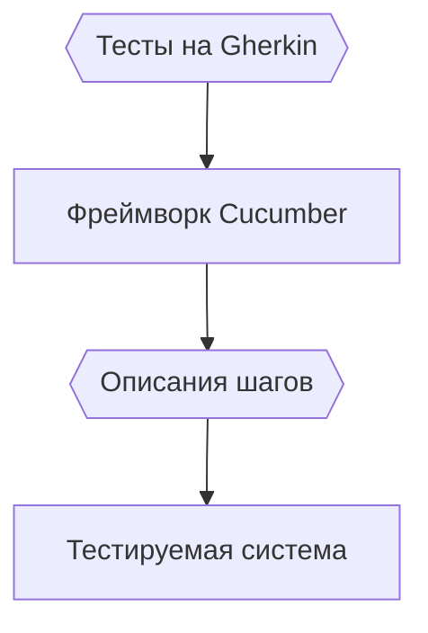
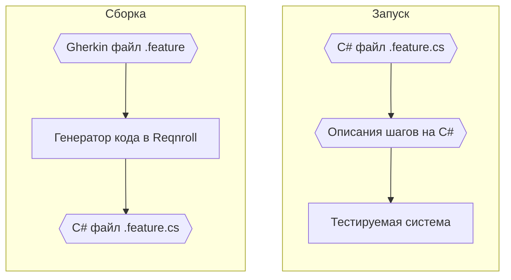

# Gherkin для приёмочных тестов

Gherkin (рус. «Корнишон») — это язык описания тестов, очень похожий на естественный язык:

- язык появился как часть проекта Cucumber (рус. «Огурец») — фреймворка для приёмочного тестирования
- язык реализует концепцию «исполняемой спецификации» или «спецификации на основе примеров»

Для приёмочных тестов API Gherkin подходит особенно хорошо: сценарии читаются как описание требований из спецификации и тут же запускаются как тесты.

## Пример теста на Gherkin

Тесты на Gherkin обычно хранятся в файлах с расширением `.feature`.

Пример теста для бэкенда мессенджера на русском диалекте Gherkin:

```gherkin
#language: ru-RU
Функциональность: Отправка сообщений
    Сценарий: отправка сообщения новому собеседнику
        Пусть в системе нет пользователя "bob"
        Когда "alice" отправляет пользователю "bob" сообщение:
        """
        Привет, bob!
        """
        Тогда "alice" видит диалог с "bob" с последним сообщением:
        """
        Привет, bob!
        """
```

В этом тесте используются:

- Директива `#language: ru-RU` для включения русского диалекта
- Русские ключевые слова
- Многострочный литерал в качестве аргумента шага «Когда … отправляет сообщение:»

Аргументом шага может быть и таблица — например, чтобы передать или проверить набор значений:

```gherkin
#language: ru-RU
Функциональность: История сообщений
    Сценарий: чтение истории диалога
        Пусть "alice" и "bob" обменялись сообщениями:
          | Автор | Текст       |
          | alice | Привет!     |
          | bob   | Здравствуй! |
        Когда "alice" запрашивает историю диалога с "bob"
        Тогда она содержит сообщения:
          | Автор | Текст       |
          | alice | Привет!     |
          | bob   | Здравствуй! |
```

## Структура теста на Gherkin

Шаги на Gherkin разделяются на три группы:

1. `Given` (`Пусть`) — шаги предварительной настройки, используют глаголы в прошедшем времени
2. `When` (`Когда`) — шаги действий, используют глаголы в настоящем времени
3. `Then` (`Тогда`) — шаги проверок, используют глаголы в будущем времени

Ключевые слова Gherkin:

| Английский | Русский          | Как используется                                  |
| ---------- | ---------------- | ------------------------------------------------- |
| Feature    | Функциональность | Описание функциональности — одно на весь файл     |
| Scenario   | Сценарий         | Название теста                                    |
| Background | Контекст         | Комментарий к тесту либо общие шаги группы тестов |
| Given      | Пусть            | Предварительная настройка (шаг Arrange)           |
| When       | Когда            | Проверяемое действие (шаг Act)                    |
| Then       | Тогда            | Проверка результата (шаг Assert)                  |
| And        | И                | Предлог, соединяющий два шага одного уровня       |
| But        | Но               | Предлог, соединяющий два шага одного уровня       |

Для параметризованных тестов (которые вряд ли нам понадобятся) есть дополнительные ключевые слова:

| Английский       | Русский         | Как используется                  |
| ---------------- | --------------- | --------------------------------- |
| Scenario outline | Шаблон сценария | Название параметризованного теста |
| Examples         | Примеры         | Значения                          |

## Выполнение теста на Gherkin

Большинство реализаций Gherkin работают как интерпретатор.

Если тесты пишутся на том же языке программирования, что и тестируемая система, то можно запускать их в одном процессе для максимальной скорости и стабильности тестов:



## Reqnroll для C#

Исторически для C# есть особенная реализация Gherkin — фреймворк Reqnroll (бывш. Specflow). Его особенность в двухэтапной обработке Gherkin:

1. Сначала тест собирается



## Создание тестов на Reqnroll (C#)

Для проекта на C# создайте отдельный проект тестов и подключите пакеты:

```bash
# Добавляем проект тестов
dotnet new xunit -o tests/ChatApi.Specs

# Добавляем ссылку на тестируемый проект
dotnet add tests/ChatApi.Specs/ reference src/ChatApi/

# Добавляем пакеты:
#   - пакет Reqnroll.xUnit также добавляет Reqnroll
#   - пакет xunit.runner.visualstudio обозначает проект как точку входа для тестов
dotnet add tests/ChatApi.Specs/ package xunit.runner.visualstudio --version 2.8.2
dotnet add tests/ChatApi.Specs/ package xunit --version 2.9.3
dotnet add tests/ChatApi.Specs/ package Reqnroll.xUnit --version 3.1.2
```

## Ссылки

Reqnroll:

1. [Reqnroll Documentation](https://docs.reqnroll.net/latest/) — документация реализации Gherkin для C#
2. [Gherkin Reference](https://docs.reqnroll.net/latest/gherkin/gherkin-reference.html)

Cucumber:

1. [Installation](https://cucumber.io/docs/installation/) — список реализаций Gherkin для различных языков.
2. [Gherkin / Reference](https://cucumber.io/docs/gherkin/reference/) — описание языка Gherkin на сайте Cucumber.
