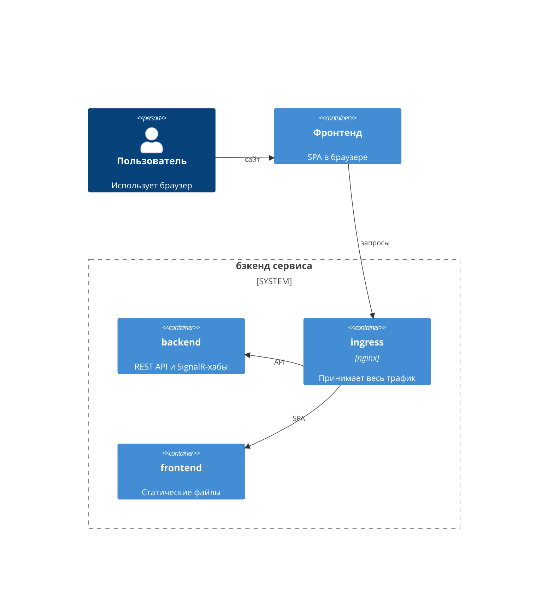
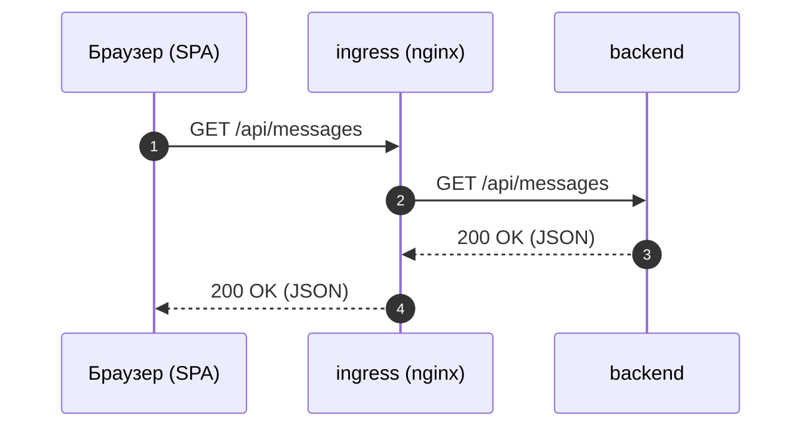
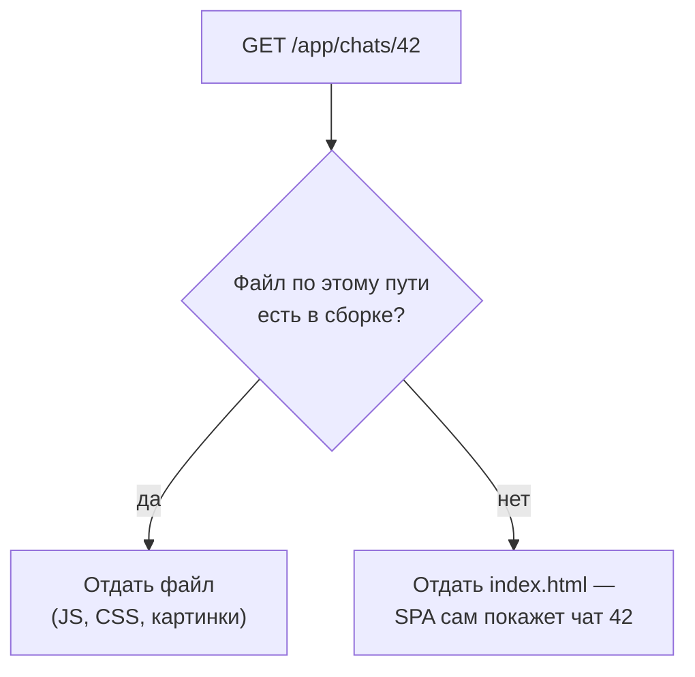
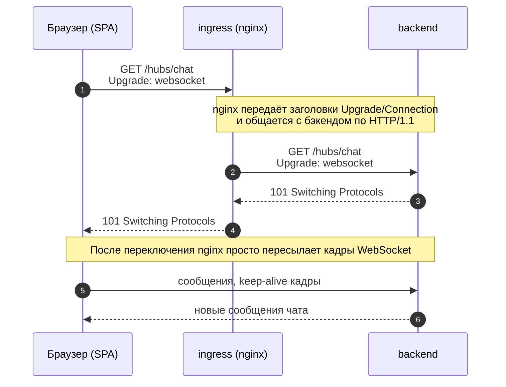

# Маршрутизация трафика через nginx

## Зачем нужна единая точка входа

Допустим, фронтенд и бэкенд запущены на localhost, но на разных портах. Это создаёт сложности:

- сайт по сути имеет несколько адресов
- браузер выполняет CORS-проверки для запросов к бэкенду с другого origin, что ограничивает работу с Cookie

>Origin — это протокол, домен и порт вместе, например `http://localhost:5173`. Для браузера `http://localhost:5173` и `http://localhost:8080` — разные origin. CORS (Cross-Origin Resource Sharing) — механизм безопасности браузера: запросы из одного origin в другой по умолчанию ограничены, и чтобы они проходили, сервер должен явно разрешить их своими заголовками ответа.

Решение — сделать единую точку входа для трафика, также известную как ingress.

Например, можно добавить контейнер с nginx, который будет принимать весь входящий трафик и маршрутизировать его между остальными контейнерами:

- браузер работает только с одним адресом `http://localhost/` и не считает никакие запросы кроссдоменными;
- nginx определяет, какой контейнер должен обработать запрос.



Здесь nginx отдаёт фронтенд как статические файлы (HTML, JS, CSS) и проксирует остальные запросы на бэкенд.

Настроим маршрутизацию по такой схеме:

| URL Path                | Кто обработает запрос | Что отвечает                 |
| ----------------------- | --------------------- | ---------------------------- |
| `/app/...`              | сам nginx             | файлы SPA из каталога сборки |
| `/api/...`, `/hubs/...` | контейнер `backend`   | JSON API и SignalR-хабы      |

## Шаг 1. Раздача статических файлов фронтенда

Структура файлов проекта показана ниже — при желании вы можете изменить её под свой проект:

- `docker-compose.yml` — конфигурация docker compose
- `frontend/public/` — каталог статики фронтенд-проекта — его раздаёт nginx
- `conf/nginx/nginx.conf` — основной файл конфигурации nginx
- `conf/nginx/conf.d/` — дополнительные файлы конфигурации nginx

Файл `docker-compose.yml`:

```yaml
services:
  ingress:
    # зафиксированная версия образа nginx
    image: nginx:1.30.5
    # монтирование «путь-на-хосте:путь-в-контейнере», суффикс :ro — read-only
    volumes:
      - ./frontend/public:/app/public:ro
      - ./conf/nginx/nginx.conf:/etc/nginx/nginx.conf:ro
      - ./conf/nginx/conf.d:/etc/nginx/conf.d:ro
    # порт 80 хоста пробрасывается в порт 80 контейнера
    # префикс 127.0.0.1 закрывает доступ с других машин сети
    ports:
      - "127.0.0.1:80:80"
```

Файл `conf/nginx/nginx.conf`:

```nginx
user  nginx;
# число рабочих процессов равно числу ядер
worker_processes auto;

# ошибки пишутся в стандартный поток ошибок — видны в docker compose logs
error_log stderr warn;
pid /var/run/nginx.pid;

events {
    worker_connections 1024;
}

http {
    include       /etc/nginx/mime.types;
    default_type  application/octet-stream;

    log_format main '$remote_addr - [$time_local] "$request" '
                    '$status $body_bytes_sent';
    # лог запросов пишется в стандартный поток вывода контейнера
    access_log /dev/fd/1 main;

    sendfile on;
    keepalive_timeout 65;

    # подключаются файлы *.conf из подкаталога conf.d
    include /etc/nginx/conf.d/*.conf;
}
```

Файл `conf/nginx/conf.d/app.conf` будет содержать правила маршрутизации, но для первого шага он будет простым:

```nginx
server {
    # nginx слушает порт 80 контейнера
    listen 80;

    # сервер обрабатывает запросы с заголовком Host: localhost
    server_name localhost;

    # относительные пути ищутся в каталоге /app/public,
    # куда смонтирован frontend/public проекта
    root /app/public;

    # для / отдаётся index.html
    # для остальных путей — файл по пути или 404
    location / {
        index index.html;
    }
}
```

Если сборки SPA ещё нет, положите в `frontend/public/index.html` простую заглушку — позже заменим её результатом сборки:

```html
<!DOCTYPE html>
<html lang="ru">
<head>
    <meta charset="utf8" />
    <title>Проверка ingress</title>
</head>
<body>
    <h1>ingress работает</h1>
</body>
</html>
```

### Проверка

```bash
docker compose up -d
curl -i http://localhost/
```

Ожидаем `HTTP/1.1 200 OK` и содержимое `index.html`. Логи nginx смотрим командой `docker compose logs -f ingress`.

Если порт 80 на вашей машине занят другим сервисом, возьмите другой порт хоста — например, `"127.0.0.1:8080:80"` — и обращайтесь по адресу `http://localhost:8080/`.

### Полезные команды docker compose

```bash
# запуск в фоновом режиме
docker compose up -d

# остановка и удаление контейнеров
docker compose down

# состояние контейнеров
docker compose ps

# непрерывный вывод логов сервиса
docker compose logs -f <сервис>

# выполнить команду внутри контейнера
docker compose exec <сервис> <команда>
```

## Шаг 2. Добавление бэкенда в docker compose

Добавим в `docker-compose.yml` сервис бэкенда. Стек может быть любым — важно лишь, что контейнер слушает некоторый порт (в примерах это 8080):

```yaml
  backend:
    # соберите образ вашего бэкенда или укажите образ из реестра
    build: ./backend
    # документирует внутренний порт бэкенда
    # наружу хоста порт не публикуется
    expose:
      - "8080"
    # docker периодически проверяет готовность бэкенда отвечать
    healthcheck:
      test: ["CMD", "curl", "-fsS", "http://localhost:8080/health"]
      # период проверки
      interval: 5s
      # таймаут одной проверки
      timeout: 3s
      # число попыток до статуса unhealthy
      retries: 3
      # в первые секунды неудачные проверки не считаются
      start_period: 10s
```

Если в образе бэкенда нет `curl`, используйте доступную команду — например `wget` или специальную утилиту образа. Путь `/health` замените на живой эндпоинт вашего API.

Теперь скажем ingress-контейнеру дождаться готовности бэкенда:

```yaml
  ingress:
    # ... образ, volumes, ports без изменений
    depends_on:
      backend:
        condition: service_healthy
```

Без `depends_on` nginx тоже не упадёт — он просто ответит `502 Bad Gateway`, пока бэкенд недоступен. Но явный порядок запуска удобен: `docker compose up -d` вернёт управление, когда система действительно готова, а не раньше.

### Проверка

```bash
docker compose up -d
docker compose ps
```

Ожидаем: `backend` в состоянии `running (healthy)`, `ingress` в состоянии `running`. Статус healthy появляется не мгновенно — дайте docker несколько секунд на первые проверки. Логи бэкенда: `docker compose logs -f backend`.

## Шаг 3. Проксирование запросов на бэкенд

Теперь направим на бэкенд все запросы, кроме будущего префикса `/app/`, который далее займёт фронтенд. Заменим содержимое блока `server` в файле `conf/nginx/conf.d/app.conf`:

```nginx
server {
    listen 80;

    server_name localhost;

    # маршрут по умолчанию — подходит любому URL Path,
    # не перехваченному более специфичными location
    location / {
        # запрос уходит контейнеру backend на порт 8080
        # путь передаётся бэкенду как есть
        proxy_pass http://backend:8080;

        # бэкенд видит исходный Host (например localhost), а не backend:8080
        proxy_set_header Host $host;
        # бэкенд видит реальный IP клиента
        proxy_set_header X-Real-IP $remote_addr;
        # IP клиента и прокси-серверов через запятую
        proxy_set_header X-Forwarded-For $proxy_add_x_forwarded_for;
        # исходная схема запроса — для корректных редиректов и абсолютных ссылок
        proxy_set_header X-Forwarded-Proto $scheme;
    }
}
```

Заголовки `X-Forwarded-*` стандартны, но по умолчанию бэкенд им не доверяет. Включите доверие на стороне бэкенда: например, для Kestrel это `UseForwardedHeaders` с настройкой известных прокси, для uvicorn — флаги `--proxy-headers --forwarded-allow-ips`. Без этого бэкенд будет считать, что все запросы пришли с IP контейнера nginx.

Как выглядит один запрос к API:



Стоит отметить, что nginx для проксируемых запросов добавляет заголовки:

1. Host, чтобы бэкенд воспринимал запрос как предназначенный для него;
2. X-Real-IP, X-Forwarded-For, X-Forwarded-Proto, чтобы бэкенд мог правильно определить настоящего клиента и, например, отдать верные URL ссылок.

### Нюанс со слэшем в proxy_pass

Если адрес не содержит пути, как в `proxy_pass http://backend:8080;`, nginx передаёт запрос на бэкенд с исходным путём без изменений. Если же после имени хоста указан путь, nginx заменяет этим путём ту часть URL, которая совпала с префиксом `location`. Для запроса `/api/users` при `location /api/` получится так:

- `proxy_pass http://backend:8080;` — бэкенд получит `/api/users`
- `proxy_pass http://backend:8080/;` — бэкенд получит `/users`
- `proxy_pass http://backend:8080/v1/;` — бэкенд получит `/v1/users`

В нашей схеме срезать префикс не требуется, поэтому везде используется адрес без пути.

Конфигурация проброшена в контейнер монтированием, поэтому после правок достаточно перечитать её командой `nginx -s reload` — перезапускать контейнер не нужно:

### Проверка

```bash
docker compose exec ingress nginx -s reload
curl -i http://localhost/api/messages
```

Подставьте путь реального эндпоинта вашего API. Ожидаем обычный ответ бэкенда.

Затем проверим поведение при недоступном бэкенде — это пригодится при отладке:

```bash
docker compose stop backend

# ожидаем 502 Bad Gateway
curl -i http://localhost/api/messages

docker compose start backend
```

- `502 Bad Gateway` — nginx работает, но бэкенд недоступен или оборвал соединение
- `504 Gateway Timeout` — бэкенд не успел ответить за `proxy_read_timeout`
- ответ бэкенда, но не тот, что вы ожидали — проверьте, куда именно смотрит маршрут; о том, как nginx находит бэкенд, рассказано далее

## Шаг 4. Как nginx находит бэкенд

В `proxy_pass http://backend:8080` имя `backend` — это имя сервиса из `docker-compose.yml`. Docker compose при запуске проекта создаёт отдельную сеть и встроенный DNS-сервер, который разрешает имена сервисов внутри этой сети. Поэтому:

1. Все контейнеры проекта видят друг друга по именам сервисов
2. Наружу хоста публикует порты только `ingress` — прямых `ports:` у бэкенда нет
3. `expose:` у бэкенда носит документационный характер: доступ внутри сети есть и без него

Отсутствие опубликованных портов у бэкенда — не случайность, а часть схемы: снаружи docker-сети до бэкенда не добраться, весь трафик идёт через единую точку входа.

Имя в `proxy_pass` разрешается в момент чтения конфигурации. Если контейнер бэкенда остановлен, команда `nginx -s reload` завершится ошибкой `host not found in upstream` — поэтому сначала запустите бэкенд и лишь затем перезагружайте конфигурацию.

Префикс `127.0.0.1:` в `ports` ingress-контейнера делает порт доступным только с локальной машины. Если нужно обращаться к сервису с других компьютеров локальной сети (например, нагружать сервис с отдельной машины при стресс-тестировании) — уберите префикс: `- "80:80"`.

### Проверка

```bash
docker compose exec ingress getent hosts backend
```

Ожидаем строку с внутренним IP-адресом контейнера бэкенда. Если имя не разрешается — проверьте, что оба сервиса описаны в одном `docker-compose.yml` и запущены.

## Шаг 5. Именованный upstream

До сих пор адрес бэкенда был записан прямо в `proxy_pass`. Правильнее вынести его в именованный `upstream` — в будущем это позволит добавить ещё несколько серверов для балансировки без изменения `location`:

```nginx
http {
    # ...

    upstream backend_servers {
        server backend:8080;
        # второй сервер для балансировки добавится одной строкой
        # server backend2:8080;
    }
}
```

И в `location`:

```nginx
    location / {
        proxy_pass http://backend_servers;
        # proxy_set_header ... — без изменений
    }
```

### Имя upstream-блока

Используйте имя, отличное от имени сервиса, — например, `backend_servers` вместо `backend`. Дело в том, что имя upstream-а имеет приоритет над DNS, поэтому при совпадении имён конфигурация становится запутанной.

### Проверка

```bash
docker compose exec ingress nginx -s reload
curl -i http://localhost/api/messages
```

Ответ бэкенда должен быть таким же, как и раньше.

## Шаг 6. Раздача SPA под префиксом /app

Перенаправим монтирование на каталог со сборкой SPA. Сначала соберите фронтенд — для vite это команда `npm run build`. Результат сборки у большинства сборщиков появляется в каталоге `dist/`:

```yaml
  ingress:
    volumes:
      - ./frontend/dist:/app/public:ro
      # ... монтирование конфигов без изменений
```

И добавим в `server` раздачу статики по префиксу `/app/`:

```nginx
    location /app/ {
        # путь /app/... отображается в файл /app/public/...
        # root вместо alias приклеил бы /app/ к пути и дал /app/public/app/...
        alias /app/public/;
        # для /app/ отдаётся index.html
        index index.html;
        # если файла нет — отдаётся index.html
        # клиентский маршрут обработает SPA
        try_files $uri $uri/ /app/index.html;
    }
```

Директива `try_files` критична для SPA. Страницы вроде `/app/chats/42` — это клиентские маршруты: файла `chats/42` в сборке нет, однако на такой URL нужно ответить не ошибкой 404, а `index.html`, иначе перезагрузка страницы «изнутри» SPA перестаёт работать:



### Базовый путь сборки

Сборщику фронтенда нужно сообщить, что SPA доступна по префиксу `/app/`. Если этого не сделать, собранное приложение будет запрашивать ассеты с корня сайта — например, `/assets/main.js` вместо `/app/assets/main.js` — и такие запросы уйдут на бэкенд, а не к статике. В vite базовый путь настраивается опцией `base: '/app/'` в конфиге сборки. Если в приложении есть клиентский роутер, префикс `/app` необходимо указать и в его настройках, поскольку все маршруты должны начинаться с того же префикса.

### Проверка

```bash
# смена volumes пересоздаст контейнер ingress
docker compose up -d

# ожидаем 200 и HTML сборки
curl -i http://localhost/app/

# ожидаем 200 и тот же index.html, а не 404
curl -i http://localhost/app/chats/42

# ожидаем 404 от бэкенда — не наш маршрут
curl -i http://localhost/assets/main.js
```

Третья проверка демонстрирует важное: `/assets/...` не подпадает под `/app/`, поэтому уходит на бэкенд. Это ещё одна причина задать правильный `base` сборки.

## Шаг 7. Проксирование WebSocket-соединений

>WebSocket — это протокол постоянного двустороннего соединения между браузером и сервером. В обычном HTTP соединение живёт ровно один запрос-ответ, поэтому сервер не может по своей инициативе отправить клиенту данные. WebSocket после особого рукопожатия оставляет соединение открытым — так обе стороны могут отправлять сообщения в любой момент, что и нужно для доставки новых сообщений чата.

Соединение WebSocket начинается как обычный HTTP-запрос с заголовками `Upgrade: websocket` и `Connection: Upgrade` — сервер подтверждает переключение протокола ответом `101 Switching Protocols`. Чтобы nginx проксировал такое соединение, нужно:

1. Передавать заголовки `Upgrade` и `Connection` на бэкенд
2. Общаться с бэкендом по HTTP/1.1 (в nginx 1.29.7+ это версия по умолчанию, но укажем явно)

Записать константу `upgrade` в заголовок `Connection` нельзя: она уместна только для websocket-запросов, тогда как обычным запросам нужно стандартное поведение keep-alive. Поэтому значение заголовка вычисляется директивой `map` — добавим её в контекст `http` файла `conf/nginx/nginx.conf`:

```nginx
http {
    # ...

    map $http_upgrade $connection_upgrade {
        default upgrade;
        ''      '';
    }
}
```

Эта запись читается так: если клиент прислал заголовок `Upgrade` с любым значением, то бэкенду передаётся `Connection: upgrade`, а если заголовок отсутствует — nginx оставляет стандартное поведение соединения.

В `location /` бэкенда добавим websocket-директивы:

```nginx
    location / {
        proxy_pass http://backend_servers;
        # proxy_set_header Host/X-Forwarded-* — как ранее

        # HTTP/1.1 — версия протокола, в которой существует апгрейд соединения
        proxy_http_version 1.1;
        # заголовок клиента передаётся бэкенду
        proxy_set_header Upgrade $http_upgrade;
        # значение из map выше
        proxy_set_header Connection $connection_upgrade;

        # nginx не рвёт «молчащее» соединение в течение часа (по умолчанию 60 секунд)
        proxy_read_timeout 3600s;
        proxy_send_timeout 3600s;
    }
```

Таймауты важны именно для чатов: если пользователь не пишет сообщения минуту, соединение не должно исчезать. Дополнительную подстраховку даёт сам SignalR — он периодически шлёт keep-alive кадры.

Схема установления websocket-соединения через прокси:



### Проверка

Живая проверка появится в следующем разделе — там будет реальный websocket-эндпоинт.

## Шаг 8. SignalR за прокси

>SignalR — это библиотека ASP.NET Core для обмена событиями между сервером и браузером в реальном времени. Обычный HTTP работает в одну сторону: клиент запросил — сервер ответил и закрыл соединение. А в чате сервер сам должен сообщить клиенту о новом сообщении, как только оно появилось. SignalR решает эту задачу: он устанавливает постоянное соединение и передаёт по нему события в обе стороны. Точки входа на стороне бэкенда называются хабами, а их пути задаются при настройке, например `/hubs/chat`.

SignalR не подключается к хабу сразу: сначала клиент отправляет POST-запрос `negotiate` и узнаёт, какие транспорты доступны, а затем выбирает лучший — WebSocket, при недоступности ServerSentEvents (SSE), затем LongPolling.

Так как хабы живут не под `/app/`, они попадают в маршрут по умолчанию, к которому websocket-директивы уже применены ранее.

### Проверка negotiate

```bash
# применяем websocket-директивы, добавленные ранее
docker compose exec ingress nginx -s reload

curl -i -X POST "http://localhost/hubs/chat/negotiate?negotiateVersion=1"
```

Подставьте путь своего хаба. Ожидаем `200 OK` и JSON со списком транспортов:

```json
{
  "negotiateVersion": 1,
  "connectionId": "9a07f2...",
  "availableTransports": [
    { "transport": "WebSockets", "transferFormats": ["Text", "Binary"] },
    { "transport": "ServerSentEvents", "transferFormats": ["Text"] },
    { "transport": "LongPolling", "transferFormats": ["Text"] }
  ]
}
```

Если вернулся `404`, путь хаба не совпадает с маршрутами бэкенда; если `502` — бэкенд недоступен.

### Проверка самого WebSocket

Откройте приложение в браузере, а затем DevTools → Network с фильтром WS. В списке должно появиться соединение вида `/hubs/chat?id=...`, а на вкладке Messages — кадры: keep-alive примерно каждые 15 секунд и сообщения чата.

Если negotiate проходит, а websocket-соединения нет — проверьте, что применили обе директивы `proxy_set_header Upgrade/Connection` и перезагрузили конфиг (`nginx -s reload`). Симптом «сообщения приходят с задержкой или пачками» означает, что клиент использует SSE-фолбэк, а nginx буферизует ответ — как это исправить, рассказано ниже.

### Буферизация и SSE-фолбэк

SSE — это ответ, который бэкенд не завершает, а дополняет новыми событиями по мере их появления. nginx по умолчанию буферизует ответы бэкенда и отдаёт их клиенту большими кусками, из-за чего события «залипают». Чтобы этого избежать, добавьте в `location /`:

```nginx
        proxy_buffering off;
```

Для учебного проекта отключение буферизации на всём маршруте бэкенда безопасно: JSON-ответы API невелики. Более точная альтернатива — выделить пути хабов в отдельный `location` — потребовала бы дублировать туда все директивы проксирования.

### Липкие сессии при масштабировании

При горизонтальном масштабировании, когда в `upstream` добавлено несколько реплик бэкенда, websocket-соединения потребуют «липких сессий» — например, `ip_hash;` в блоке `upstream`, чтобы клиент всегда попадал на тот же сервер.

## Шаг 9. Dev-сервер фронтенда за nginx

Пересобирать фронтенд после каждой правки слишком медленно. Dev-сервер сборщика пересобирает модули на лету и обновляет страницу через HMR, который тоже использует websocket-соединение. Запустим dev-сервер отдельным контейнером за nginx.

>HMR (Hot Module Replacement, «горячая замена модулей») — механизм dev-сервера: при сохранении файла он подменяет изменённый модуль прямо в открытой странице, без её полной перезагрузки, по возможности сохраняя состояние приложения.

Файл `docker-compose.override.yml` (docker compose применяет его автоматически поверх основного файла):

```yaml
services:
  frontend-dev:
    # dev-сервер вашего сборщика (пример для vite)
    build: ./frontend
    command: npm run dev -- --host 0.0.0.0 --port 5173
    expose:
      - "5173"
```

Флаг `--host 0.0.0.0` обязателен: без него dev-сервер слушает только localhost своего контейнера, и nginx его не достанет.

Теперь на время разработки переключим `/app/` со статики на проксирование в dev-сервер:

```nginx
    location /app/ {
        proxy_pass http://frontend-dev:5173;

        # HMR-соединение — тоже websocket
        proxy_http_version 1.1;
        proxy_set_header Upgrade $http_upgrade;
        proxy_set_header Connection $connection_upgrade;
        proxy_read_timeout 3600s;
    }
```

Dev-сервер сам отдаёт SPA по префиксу `base`, поэтому путь передаётся как есть. Обратите внимание, что здесь применяется уже знакомый паттерн websocket-проксирования: HMR-соединение тоже требует заголовков `Upgrade`/`Connection`.

Запросы к API из dev-режима идут через тот же origin `http://localhost/` на маршрут бэкенда — CORS не нужен.

### Проверка

```bash
docker compose up -d
```

Откройте `http://localhost/app/`, внесите правку в компонент — изменения должны появиться в браузере без перезагрузки страницы. В DevTools → Network → WS видно HMR-соединение.

Чтобы вернуться к раздаче сборки, верните `location /app/` со статикой и удалите или переименуйте `docker-compose.override.yml` — иначе compose продолжит запускать `frontend-dev`.

## Шаг 10. Кеш и gzip для статики

Сборщики кладут ассеты с хешами содержимого в именах (`assets/index-CfHJ3.js`) — при изменении кода меняется имя, поэтому такие файлы можно кешировать надолго. Точка входа `index.html`, наоборот, меняется при каждом релизе — кешировать её нельзя, иначе клиент не узнает о новой сборке.

Добавим в `server`:

```nginx
    # ассеты с хешами в именах кешируем надолго
    # префикс /app/assets/ длиннее /app/, поэтому кеш касается только ассетов
    location /app/assets/ {
        alias /app/public/assets/;
        # браузер хранит файл 180 дней и не перевалидирует его
        expires 180d;
        add_header Cache-Control "public, immutable";
    }

    # точный маршрут для точки входа SPA
    # сюда в итоге попадает try_files из location /app/
    location = /app/index.html {
        alias /app/public/index.html;
        # index.html меняется при каждом релизе — кешировать нельзя
        add_header Cache-Control "no-cache";
    }

    # Сжатие текстовых форматов «на лету»
    gzip on;
    # сжимаются CSS, JS, JSON, SVG
    # HTML сжимается всегда при включённом gzip
    gzip_types text/css application/javascript application/json image/svg+xml;
    # уровень сжатия от 1 до 9
    # 6 — разумный компромисс
    gzip_comp_level 6;
```

Нет смысла сжимать PNG/JPEG/WEBP, видео и шрифты WOFF/WOFF2 — сжатие уже заложено в их формат.

### Проверка

```bash
docker compose exec ingress nginx -s reload

# ожидаем cache-control: no-cache
curl -sI http://localhost/app/index.html | grep -i cache-control

# подставьте имя реального ассета из вашей сборки
curl -sI http://localhost/app/assets/index-CfHJ3.js | grep -iE 'cache-control|expires'

# ожидаем content-encoding: gzip
curl -sI -H 'Accept-Encoding: gzip' http://localhost/app/index.html | grep -i content-encoding
```

## Шаг 11. Ограничение частоты запросов

Перед стресс-тестированием полезно ограничить частоту запросов на клиента — так бэкенд не «ляжет» от одного шумного пользователя или от бага в клиенте.

В контекст `http` файла `nginx.conf` добавим зону счётчиков:

```nginx
http {
    # ...

    # счётчики ведутся по IP клиента
    # зоны на 10 МБ хватает примерно на 160 тысяч адресов
    limit_req_zone $binary_remote_addr zone=api_per_ip:10m rate=20r/s;
}
```

И применим её в маршруте бэкенда:

```nginx
    location / {
        # ... директивы проксирования без изменений

        # короткие всплески до 40 запросов пропускаются сразу, без задержек
        limit_req zone=api_per_ip burst=40 nodelay;
        # лишние запросы получают 429 (по умолчанию 503)
        limit_req_status 429;
    }
```

Лимит действует и на рукопожатия websocket — это ожидаемое поведение, которое стоит учитывать при подборе `rate`.

### Проверка

```bash
docker compose exec ingress nginx -s reload
for i in $(seq 1 100); do
  curl -s -o /dev/null -w "%{http_code}\n" http://localhost/api/messages
done | sort | uniq -c
```

Подставьте лёгкий GET-эндпоинт вашего API. Ожидаем смесь кодов: часть `200`, часть `429`.

## Итоговая конфигурация и чек-лист

`docker-compose.yml`:

```yaml
services:
  ingress:
    image: nginx:1.30.5
    depends_on:
      backend:
        condition: service_healthy
    volumes:
      - ./frontend/dist:/app/public:ro
      - ./conf/nginx/nginx.conf:/etc/nginx/nginx.conf:ro
      - ./conf/nginx/conf.d:/etc/nginx/conf.d:ro
    ports:
      - "127.0.0.1:80:80"

  backend:
    # образ вашего бэкенда
    build: ./backend
    expose:
      - "8080"
    healthcheck:
      test: ["CMD", "curl", "-fsS", "http://localhost:8080/health"]
      interval: 5s
      timeout: 3s
      retries: 3
      start_period: 10s

  # Для dev-режима — docker-compose.override.yml с frontend-dev
```

`conf/nginx/nginx.conf`:

```nginx
user  nginx;
worker_processes auto;

error_log stderr warn;
pid /var/run/nginx.pid;

events {
    worker_connections 1024;
}

http {
    include       /etc/nginx/mime.types;
    default_type  application/octet-stream;

    log_format main '$remote_addr - [$time_local] "$request" '
                    '$status $body_bytes_sent';
    access_log /dev/fd/1 main;

    sendfile on;
    keepalive_timeout 65;

    # Заголовок Connection для проксируемых запросов
    map $http_upgrade $connection_upgrade {
        default upgrade;
        ''      '';
    }

    # Норма запросов на клиента
    limit_req_zone $binary_remote_addr zone=api_per_ip:10m rate=20r/s;

    # Пул серверов бэкенда
    upstream backend_servers {
        server backend:8080;
    }

    include /etc/nginx/conf.d/*.conf;
}
```

`conf/nginx/conf.d/app.conf`:

```nginx
server {
    listen 80;

    server_name localhost;

    # Сжатие статики
    gzip on;
    gzip_types text/css application/javascript application/json image/svg+xml;
    gzip_comp_level 6;

    # --- Фронтенд: собранная SPA ---

    location /app/ {
        alias /app/public/;
        index index.html;
        try_files $uri $uri/ /app/index.html;
    }

    # Ассеты с хешами в именах — кешируем
    location /app/assets/ {
        alias /app/public/assets/;
        expires 180d;
        add_header Cache-Control "public, immutable";
    }

    # Точка входа SPA — не кешировать
    location = /app/index.html {
        alias /app/public/index.html;
        add_header Cache-Control "no-cache";
    }

    # --- Остальное — на бэкенд ---

    location / {
        proxy_pass http://backend_servers;

        proxy_set_header Host $host;
        proxy_set_header X-Real-IP $remote_addr;
        proxy_set_header X-Forwarded-For $proxy_add_x_forwarded_for;
        proxy_set_header X-Forwarded-Proto $scheme;

        # WebSocket
        proxy_http_version 1.1;
        proxy_set_header Upgrade $http_upgrade;
        proxy_set_header Connection $connection_upgrade;
        proxy_read_timeout 3600s;
        proxy_send_timeout 3600s;

        # SSE-фолбэк SignalR
        proxy_buffering off;

        # Ограничение частоты запросов
        limit_req zone=api_per_ip burst=40 nodelay;
        limit_req_status 429;
    }
}
```

Итоговая таблица маршрутов:

| URL Path          | Маршрут                      | Ответ                                            |
| ----------------- | ---------------------------- | ------------------------------------------------ |
| `/app/assets/...` | `location /app/assets/`      | файл сборки с кешем 180 дней                     |
| `/app/index.html` | `location = /app/index.html` | точка входа SPA без кеша                         |
| `/app/...`        | `location /app/`             | файлы сборки; клиентские маршруты → `index.html` |
| всё остальное     | `location /`                 | проксирование на бэкенд: API, SignalR-хабы       |

### Быстрая проверка всей системы

```bash
# ожидаем backend: running (healthy)
docker compose ps

# ожидаем 200 и HTML сборки
curl -i http://localhost/app/

# ожидаем 200 и index.html, а не 404
curl -i http://localhost/app/chats/42

# ожидаем ответ API
curl -i http://localhost/api/messages

# ожидаем 200 и JSON со списком транспортов
curl -i -X POST "http://localhost/hubs/chat/negotiate?negotiateVersion=1"
```

Напоследок откройте приложение в браузере и убедитесь, что в DevTools → Network → WS видно websocket-соединение и кадры сообщений. Для стресс-тестирования запустите показанный ранее цикл с curl — он должен показать смесь кодов 200 и 429.
